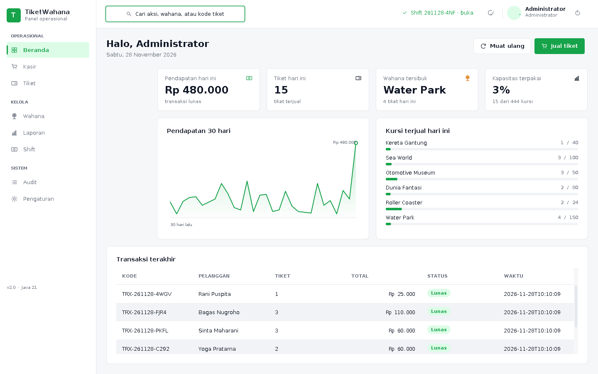
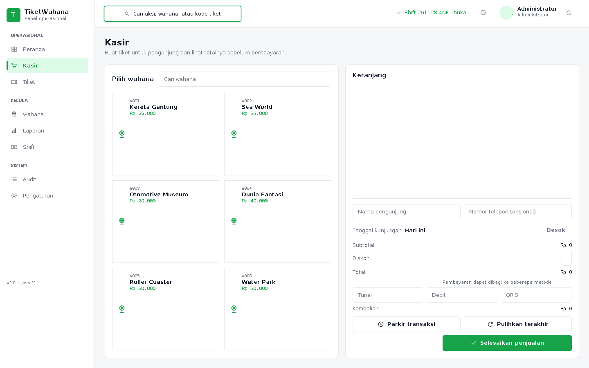
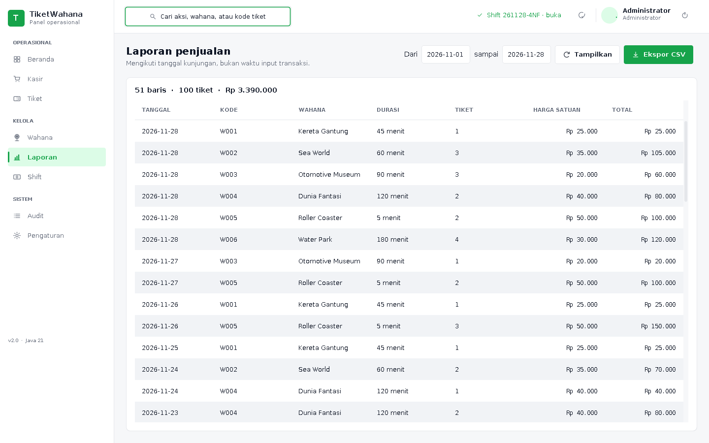

# TiketWahana

Aplikasi desktop untuk mengelola penjualan tiket taman hiburan: katalog wahana, kasir, validasi tiket masuk, shift kas, laporan, dan audit. Dibangun dengan Java Swing dan Java2D di atas Java 17, JDBC, dan MySQL 8 — tanpa framework UI, tanpa ORM.



## Fitur

**Kasir**
- Keranjang multi-wahana dengan jumlah tiket per baris, diskon, dan parkir/pulihkan transaksi
- Pembayaran terpisah untuk tunai, debit, dan QRIS, dengan kembalian yang dihitung dari ledger
- Pemeriksaan kapasitas per wahana per tanggal kunjungan sebelum tiket dicetak
- Struk dengan pratinjau Java2D, cetak ke printer, dan ekspor PDF



**Tiket dan pintu masuk**
- Validasi kode tiket sekali pakai; tiket yang sudah dipakai atau direfund ditolak dengan alasan
- Riwayat tiket beserta status dan petugas yang memvalidasi

**Operasional**
- Shift kasir: modal awal, kas yang diharapkan, kas terhitung, dan selisih
- Peran `ADMIN`, `MANAGER`, dan `KASIR` dengan izin yang diperiksa di lapisan service
- Audit trail untuk login, penjualan, pembatalan, validasi tiket, perubahan harga, dan shift

**Laporan**
- Rekap per tanggal kunjungan dan per wahana
- Ekspor CSV
- Tren pendapatan 30 hari dan peta kunjungan yang digambar dengan Java2D



**Antarmuka**
- Tema terang dan gelap yang tersimpan, font Inter dan JetBrains Mono yang dibundel
- Navigasi keyboard: `Ctrl+K` command palette, `F2` kasir, `F5` muat ulang, `Ctrl+J` tema
- Komponen, ikon, dan grafik digambar sendiri; tidak ada paket ikon atau pustaka chart

## Menjalankan

Kebutuhan: JDK 17+, Maven 3.9+ (atau gunakan `./mvnw`).

```bash
./mvnw -B verify
./mvnw -q exec:java
```

Konfigurasi database dibaca dari `db.properties` di direktori kerja, `~/.tiketwahana/db.properties`, atau `-Dtiket.config=/path/db.properties`. Nilai bawaan mengikuti setup XAMPP:

```properties
db.url=jdbc:mysql://localhost:3306/ticket_wahana_db?useSSL=false&allowPublicKeyRetrieval=true&serverTimezone=Asia/Jakarta
db.user=root
db.password=
```

Saat pertama dijalankan aplikasi membuat tabel yang belum ada dan menerapkan migrasi bernomor dari `src/main/resources/db/migrations`. Akun awal:

| Username | Password sementara |
| --- | --- |
| `admin` | `admin12345` |

Password baru (minimal 8 karakter) wajib dibuat saat login pertama. Password disimpan sebagai hash PBKDF2-HMAC-SHA256 dengan salt per akun, dan login ditolak bila database tidak dapat dihubungi — tidak ada akun cadangan.

### MySQL sementara dengan Docker

```bash
docker run --name tiketwahana-mysql \
  -e MYSQL_ROOT_PASSWORD=dev \
  -e MYSQL_DATABASE=ticket_wahana_db \
  -p 3306:3306 -d mysql:8
```

```properties
db.url=jdbc:mysql://localhost:3306/ticket_wahana_db?useSSL=false&allowPublicKeyRetrieval=true&serverTimezone=Asia/Jakarta
db.user=root
db.password=dev
```

`database_schema.sql` juga bisa diimpor langsung lewat phpMyAdmin untuk database kosong.

## Struktur

```
src/main/java/com/mycompany/tiketwahana/
├── MainApp.java          entry point
├── core/                 koneksi, pool, migrasi, uang, auth, audit, sesi
├── domain/               record domain (wahana, tiket, transaksi, shift)
├── service/              aturan bisnis dan seluruh akses database
└── ui/                   tema, komponen, shell, layar, chart, struk
    └── screens/          dashboard, kasir, tiket, wahana, laporan, shift, audit, pengaturan
src/main/resources/
├── db/migrations/        skema bernomor
└── fonts/                Inter dan JetBrains Mono (OFL)
```

Aturan yang dipegang:

- **Uang selalu `BigDecimal`.** `Money` menangani parsing, pembulatan, dan format Rupiah; nilai dari layar tidak pernah dipakai untuk menghitung ulang total.
- **Satu penjualan satu transaksi.** `transaksi`, `transaksi_detail`, dan satu baris `tiket` per kursi di-commit bersama atau dibatalkan bersama. Koneksi yang dikembalikan ke pool selalu di-rollback dan dikembalikan ke auto-commit.
- **Laporan memakai tanggal kunjungan.** Waktu input transaksi hanya dipakai untuk analitik penjualan.
- **Tidak ada tombol palsu.** Backup, restore, dan log sistem yang tidak berjalan dihapus, bukan dibuat seolah berhasil.
- **Semua query di luar EDT.** Setiap akses database berjalan di `SwingWorker`.

## Pengujian

```bash
./mvnw -B clean verify
```

Mencakup parsing dan format uang, hashing password dan kebijakan password, pemisahan statement migrasi, checksum Code 128, serta paint headless seluruh layar pada 1440×900 dan 1024×768 di kedua tema.

Uji integrasi opsional terhadap MySQL 8:

```bash
./mvnw -B -Dmysql.smoke=true \
  -Dmysql.url='jdbc:mysql://127.0.0.1:3306/ticket_wahana_db?useSSL=false&allowPublicKeyRetrieval=true&serverTimezone=UTC' \
  -Dmysql.password=dev test
```

Uji ini menjalankan migrasi pada database kosong, membuat shift, menjual tiket lintas wahana, memeriksa keseimbangan `transaksi` = `transaksi_detail` = `tiket`, memvalidasi tiket, menolak validasi kedua, mengekspor struk PDF, lalu menutup shift dengan selisih nol.

Tangkapan layar di `docs/screenshots` dihasilkan dari aplikasi yang benar-benar berjalan di atas database berisi data:

```bash
./mvnw -q test-compile
./mvnw -q dependency:build-classpath -Dmdep.outputFile=cp.txt
xvfb-run -a java -cp "target/classes:target/test-classes:$(cat cp.txt)" \
  -Dmysql.url='jdbc:mysql://127.0.0.1:3306/ticket_wahana_db?useSSL=false&allowPublicKeyRetrieval=true&serverTimezone=UTC' \
  -Dmysql.password=dev com.mycompany.tiketwahana.docs.CaptureMain
```

## Stack

Java 17 · Swing / Java2D · JDBC · MySQL 8 · Maven · JUnit 5

## Lisensi

Kode aplikasi dilisensikan di bawah [MIT License](LICENSE).

Komponen pihak ketiga memakai lisensinya masing-masing: font Inter dan JetBrains Mono
(SIL Open Font License 1.1, teks lengkap ada di `src/main/resources/fonts/`),
MySQL Connector/J (GPL v2 dengan Universal FOSS Exception), serta JUnit 5 dan
Maven Wrapper untuk pengujian dan build. Rincian ada di
[THIRD-PARTY-NOTICES.md](THIRD-PARTY-NOTICES.md).
